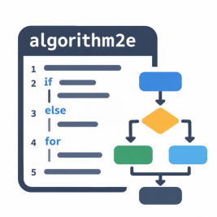
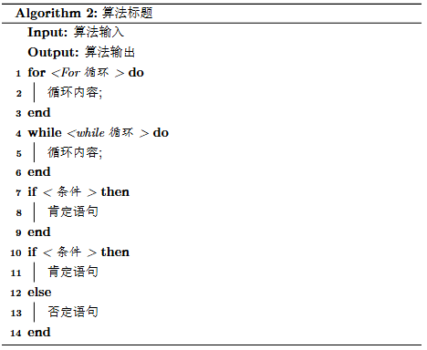
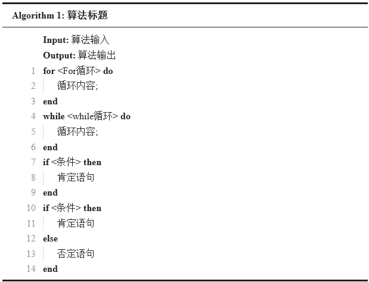
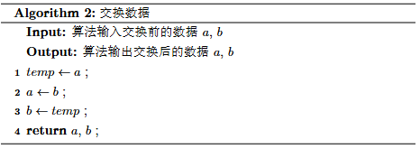
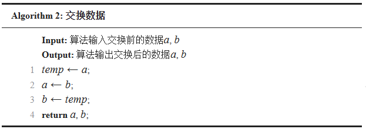
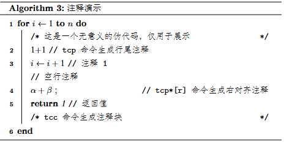
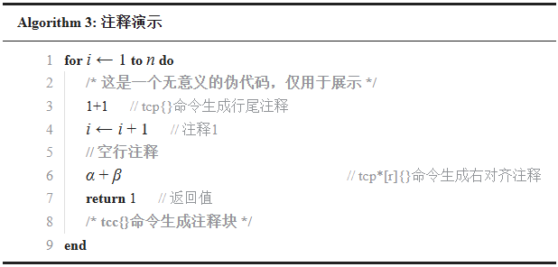
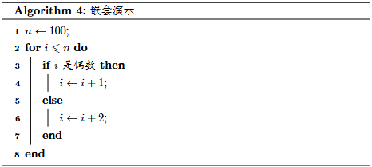
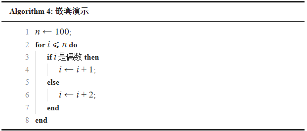

<p align="center">

<br>

<p align="center">
    <strong>SiYuan Note Plugin</strong>
    <br>
    Use LaTeX algorithm2e syntax to write and display pseudocode in SiYuan.
    <br>
    No external dependencies · Free editing · Free sharing
</p>

<p align="center">
    <a href="https://github.com/ZhenRRongGuo/siyuan-algorithm2e/blob/main/README_zh_CN.md">Chinese</a> | <a href="https://github.com/ZhenRRongGuo/siyuan-algorithm2e/blob/main/README.md">English</a>
</p>

---

## Notice

* This plugin is made with reference to [YuxinZhaozyx/siyuan-embed-pseudocode](https://github.com/YuxinZhaozyx/siyuan-embed-pseudocode)
* LaTeX has two ways to use pseudocode: one method relies on the `algorithm` + `algorithmic` packages, and the other relies on the `algorithm2e` package.
  * If you prefer to use the `algorithm` + `algorithmic` packages, please use the [YuxinZhaozyx/siyuan-embed-pseudocode](https://github.com/YuxinZhaozyx/siyuan-embed-pseudocode) plugin.
  * If you prefer to use the `algorithm2e` package, please use this plugin.
  
> <span style="color: red; font-weight: bold;">⚠️ This project relies heavily on AI in its development. Although I have not found any problems in my own use so far, please evaluate the risks yourself.</span>

## Demonstration


<details>
<summary> Pseudocode source </summary>

```
\begin{algorithm}
    \caption{Algorithm Title}
    \KwIn{Algorithm Input}
    \KwOut{Algorithm Output}
    \For{<For loop>}{
        Loop body\;
    }
    \While{<while loop>}{
        Loop body\;
    }
    \If{<condition>}{
        Positive statement
    }
    \eIf{<condition>}{
        Positive statement}{
        Negative statement
    }
\end{algorithm}
```
</details>


<table>
  <thead>
    <tr>
      <th align="center">LaTeX Result</th>
      <th align="center">Siyuan Result</th>
    </tr>
  </thead>
  <tbody>
    <tr>
      <td align="center" valign="middle">
        
      </td>
      <td align="center" valign="middle">
        
      </td>
    </tr>
  </tbody>
</table>

<details>
<summary> Pseudocode source (math rendering demonstration) </summary>

```
\begin{algorithm}
    \caption{Swap Data}
    \KwIn{Algorithm input: data before swapping $a$, $b$}
    \KwOut{Algorithm output: data after swapping $a$, $b$}
    $temp \gets a$ \;
    $a \gets b$ \;
    $b \gets temp$ \;
    \Return $a$, $b$ \;
\end{algorithm}
```
</details>

<table>
  <thead>
    <tr>
      <th align="center">LaTeX Result</th>
      <th align="center">Siyuan Result</th>
    </tr>
  </thead>
  <tbody>
    <tr>
      <td align="center" valign="middle">
        
      </td>
      <td align="center" valign="middle">
        
      </td>
    </tr>
  </tbody>
</table>


<details>
<summary> Pseudocode source (comment demonstration) </summary>

```
\begin{algorithm}
    \caption{Comment Demonstration}
    \For{$i \gets 1$ \KwTo $n$}{
        \tcc{This is meaningless pseudocode, only for demonstration}
        1+1 \tcp{tcp{} command generates an end-of-line comment}
        $i\gets i+1$ \tcp{Comment 1}
        \tcp{Blank-line comment}
        $\alpha+\beta$ \tcp*[r]{tcp*[r]{} command generates a right-aligned comment}
        \Return{1} \tcp{Return value}
        \tcc{tcc{} command generates a comment block}
    }
\end{algorithm}
```
</details>


<table>
  <thead>
    <tr>
      <th align="center">LaTeX Result</th>
      <th align="center">Siyuan Result</th>
    </tr>
  </thead>
  <tbody>
    <tr>
      <td align="center" valign="middle">
        
      </td>
      <td align="center" valign="middle">
        
      </td>
    </tr>
  </tbody>
</table>

<details>
<summary> Pseudocode source (nesting demonstration) </summary>

```
\begin{algorithm}
    \caption{Nesting Demonstration}
    $n \gets 100$\;
    \For{$i \leqslant n$}{
        \eIf{$i$ is even}{
            $i \gets i+1$\;
        }{
            $i \gets i+2$\;
        }
    }
\end{algorithm}
```
</details>

<table>
  <thead>
    <tr>
      <th align="center">LaTeX Result</th>
      <th align="center">Siyuan Result</th>
    </tr>
  </thead>
  <tbody>
    <tr>
      <td align="center" valign="middle">
        
      </td>
      <td align="center" valign="middle">
        
      </td>
    </tr>
  </tbody>
</table>

## Features

- [x] Offline use without network
- [x] CodeMirror editor (syntax highlighting, code autocompletion, error prompts)
- [x] Set the display style of pseudocode blocks
- [x] Store pseudocode as native Markdown code blocks
- [x] PDF export support
- [x] Support rendering of SiYuan KaTeX macro definition commands

> If you have additional feature requests or suggestions, feel free to [open an issue on GitHub](https://github.com/ZhenRRongGuo/siyuan-algorithm2e/issues)

## Usage Guide

**Create pseudocode:** Enter the `/algorithm2e` command in the editor to create new pseudocode.

**Edit pseudocode:** Click the menu button on the left/top-right of the code block. If the code block is recognized as a pseudocode block (a code block whose language is `algorithm2e`), the `Edit Pseudocode` option will appear; click it to edit.

**Switch pseudocode view:** Click the menu button on the left/top-right of the code block. If the code block is recognized as a pseudocode block (a code block whose language is `algorithm2e`), the `Enable Pseudocode View` / `Disable Pseudocode View` option will appear; click it to switch.

## Changelog

+ v0.1.0
    + First release
